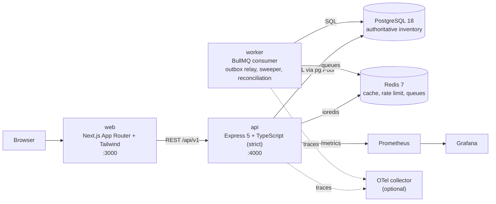
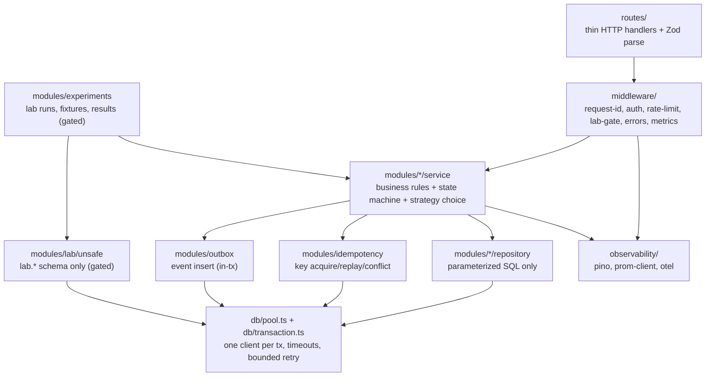
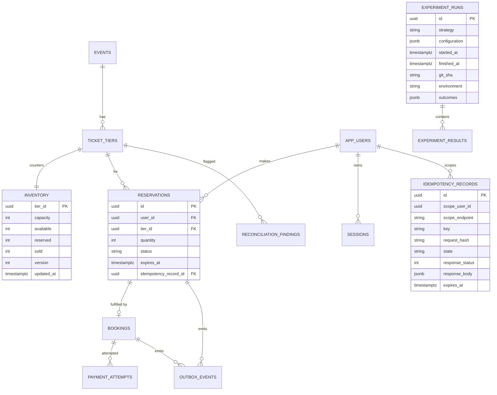

# C4 Diagrams and ERD

All diagrams are Mermaid, renderable on GitHub. They describe the implemented system; where Phase 5/6
components are not yet built they are marked *(later phase)*.

## 1. Context

```mermaid
graph TB
    subgraph Humans
        V["Visitor<br/>wants tickets"]
        E["Engineer / SRE<br/>runs experiments"]
    end
    subgraph TicketFlow["TicketFlow Reliability Lab"]
        S["TicketFlow system<br/>Node.js + PostgreSQL"]
    end
    P["Fake payment provider<br/>(deterministic, local, no funds)"]
    M["Prometheus / Grafana<br/>metrics & dashboards"]
    L["k6<br/>load generator"]

    V -->|browse, reserve, fake-pay| S
    E -->|build/run/compare experiments| S
    S -->|simulate success/failure/timeout| P
    S -->|exposes /metrics| M
    L -->|drives HTTP load (local only)| S
    E -->|reads| M
```

## 2. Containers



## 3. Components inside `api`



## 4. ERD (authoritative tables)



The `lab` schema mirrors `INVENTORY` and `RESERVATIONS` for the unsafe baseline and has no FK to
public tables (ADR-0009).

## 5. Reservation lifecycle (state view)

```mermaid
stateDiagram-v2
    [*] --> PENDING : reserve (available - q, reserved + q)
    PENDING --> CONFIRMED : fake payment success (reserved - q, sold + q)
    PENDING --> CANCELED : user cancel (reserved - q, available + q)
    PENDING --> EXPIRED : TTL elapsed (reserved - q, available + q)
    CONFIRMED --> [*]
    CANCELED --> [*]
    EXPIRED --> [*]
    FAILED --> [*]
    note right of PENDING : terminal states cannot transition; illegal\ntransitions are rejected with 409 invalid_transition
```


